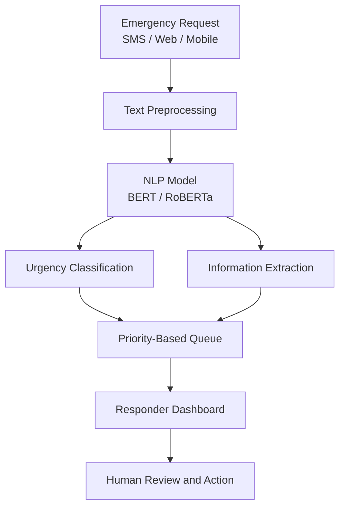

# AI-Assisted Disaster Relief Request Prioritization Using NLP

**Main Project | Department of Computer Science and Engineering**

## Abstract

Natural disasters generate large volumes of emergency requests through SMS, social media, and mobile applications. Manually reviewing these messages can delay the identification of critical needs. This project proposes an AI-assisted disaster relief request prioritization system that uses Natural Language Processing (NLP) and transformer-based models to classify emergency messages according to urgency. It also aims to extract important information, including location, disaster type, required resources, and medical needs. Requests are organized into priority levels and presented through a responder interface to support faster assessment and resource allocation. The system is designed to assist emergency response personnel while retaining human oversight for critical decisions.

## Problem Statement

Manual screening of disaster-related emergency messages is time-consuming and makes it difficult to identify urgent requests promptly. An automated system is needed to classify requests by urgency, extract relevant information, and organize them for efficient human review.

## Objectives

- Automate the analysis of unstructured emergency messages.
- Classify requests into **High, Medium, and Low** urgency levels.
- Extract locations, disaster types, medical needs, and required resources.
- Organize requests in a priority-based queue.
- Support responders in reviewing requests and allocating resources efficiently.

## Proposed Solution

The proposed system combines NLP, information extraction, and transformer-based classification to process emergency requests.

| Component | Responsibility | Planned Technology |
|---|---|---|
| Request Collection | Receive emergency messages | Web / SMS / Mobile inputs |
| Text Preprocessing | Clean and prepare text | Python, NLP |
| Urgency Classification | Predict request priority | BERT / RoBERTa |
| Information Extraction | Identify locations, needs, and disaster details | Named Entity Recognition (NER) |
| Priority Management | Organize requests by urgency | Rule-based queue |
| Responder Interface | Display requests for review | Web-based interface |

*BERT and RoBERTa are candidate models to evaluate; the final model will be selected based on testing.*

## System Architecture

## Workflow

1. **Input:** Collect emergency requests from supported channels.
2. **Preprocessing:** Clean and normalize the submitted text.
3. **Classification:** Estimate the urgency of each request.
4. **Information Extraction:** Identify location, disaster type, and assistance requirements.
5. **Prioritization:** Arrange requests according to predicted urgency.
6. **Presentation:** Display structured requests through a responder interface.
7. **Human Review:** Enable response personnel to verify details and decide on appropriate action.

## Key Features

- Automated urgency classification.
- Extraction of important emergency details.
- Priority-based request organization.
- Structured presentation of unformatted messages.
- Support for faster human assessment.
- Modular design for future integration with additional communication channels.

## Key Merits

- Reduces the burden of manual message screening.
- Helps identify potentially critical requests earlier.
- Improves the organization of emergency information.
- Supports more informed resource allocation.
- Can be extended to accommodate different disaster scenarios.

## Area of the Project

Artificial Intelligence, Natural Language Processing, Machine Learning, Transformer Models, Text Classification, Named Entity Recognition, Information Extraction, and Disaster Management.

## Literature Review

The project follows a progression from disaster-related text analytics toward intelligent emergency request prioritization.

1. **AI and NLP in Social Good: Enhancing Disaster Response and Crisis Management with Text Analytics** — explores text analytics for extracting useful insights from disaster-related communications.

2. **NLP-Based Disaster Monitoring and Information Extraction** — focuses on techniques such as sentiment analysis, location intelligence, and Named Entity Recognition to understand disaster-related messages.

3. **Text Classification and Topic Modelling for Disaster Information Analysis** — investigates methods such as TF-IDF, K-Means, LDA, LSA, NMF, and CNN-based classification for organizing and categorizing text.

4. **Intelligent Emergency Notification Mobile Service via Multi-task BERT Models** — the selected base paper, informing the project's direction toward transformer-based analysis and intelligent emergency notification.

*Note: Confirm the exact titles, authors, publication years, and methods against the original papers before using this section as a formal bibliography. The progression above describes the intended project rationale, not independently verified experimental results from the papers.*

## Current Progress

Update this section as development advances.

- [ ] Finalize project requirements and system design.
- [ ] Prepare and inspect the emergency-request dataset.
- [ ] Implement text preprocessing.
- [ ] Develop and evaluate BERT and RoBERTa classification.
- [ ] Implement information extraction.
- [ ] Develop priority-based request management.
- [ ] Build the responder interface.
- [ ] Test classification performance and end-to-end workflow.

## Evaluation Metrics

The classification component will be evaluated using:

- **Accuracy:** Overall proportion of correct predictions.
- **Precision:** Proportion of predicted priority labels that are correct.
- **Recall:** Proportion of actual priority cases identified.
- **F1-score:** Balance between precision and recall.
- **Response organization time:** Time required to organize incoming requests for review.

Recall for high-urgency requests will receive particular attention, since missing a critical request may have serious consequences.

## Future Scope

- Integrate real-time inputs from additional communication channels.
- Support multilingual emergency messages.
- Improve location extraction and geospatial visualization.
- Evaluate the system on diverse disaster scenarios.
- Add monitoring, audit logs, and responder feedback.
- Explore integration with emergency response organizations.

## Ethical Considerations

- Treat model-generated priorities as decision-support recommendations, not final emergency decisions.
- Preserve human oversight for request verification and dispatch.
- Protect personal information and sensitive location details.
- Evaluate performance across languages, message styles, and disaster scenarios.
- Communicate uncertainty and avoid presenting unverified information as fact.

## Conclusion

The project aims to transform unstructured disaster-related messages into organized, urgency-ranked requests with essential information extracted for review. By combining NLP, transformer-based classification, and a responder-facing interface, it seeks to support faster assessment and more efficient coordination during disaster response while keeping human judgment central.

---

**Project Status:** Under Development  
**Primary Focus:** AI-Assisted Emergency Request Prioritization  
**Core Technologies:** Python, NLP, BERT, RoBERTa, NER
